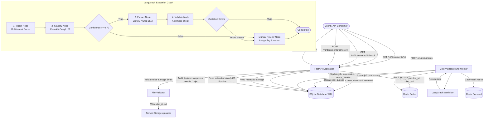

# AI Document Processing Agent

Asynchronous document intelligence, multi-format parsing, extraction, and validation pipeline built with FastAPI, Celery, Redis, LangGraph, and CrewAI.

## Overview

This repository implements an asynchronous document processing service engineered to ingest semi-structured business documents (invoices, contracts, and correspondence). Incoming documents are validated via HTTP, staged to server storage, persisted in a persistent SQLite repository, enqueued for background Celery execution, and processed through a stateful LangGraph workflow. The workflow classifies content using an LLM discriminator, extracts structured key-value entities, applies deterministic arithmetic validation, and routes uncertain or inconsistent documents to an actionable human review workflow.

### Key Capabilities

* **Asynchronous Multi-Format Ingestion**: Accepts plain text (`.txt`), text-based PDF (`.pdf`), and Microsoft Word (`.docx`) files. Requests are acknowledged immediately with HTTP 202 and a status URL.
* **Format and Signature Validation**: Enforces maximum upload sizes (10 MB default), extension allowlisting, and binary magic-byte validation (for example, `%PDF-` headers for PDF and zip signatures for DOCX).
* **Cross-Process Persistence**: Job state and lifecycle stages are tracked in a persistent SQLite database with Write-Ahead Logging (WAL) enabled, ensuring data integrity across web and worker processes without relying on process-local memory.
* **Discriminator Classification**: Uses structured prompting with Groq-hosted Llama 3.1 8B to classify document types and identify ambiguous correspondence discussing contracts or invoices.
* **Prompt Injection Hardening**: Prompts enforce security boundaries treating document text strictly as untrusted passive data, preventing instructions inside documents from altering agent roles or tool execution.
* **Stateful Conditional Routing**: Documents scoring above threshold (default: 0.70) proceed to structured extraction. Documents with low confidence or empty text route to manual review.
* **Deterministic Post-Extraction Validation**: Validates invoice calculations (subtotal + tax == total_due). Arithmetic discrepancies route the document to manual review.
* **Human-in-the-Loop Review Lifecycle**: Provides an explicit review endpoint (`POST /v1/documents/{id}/review`) supporting `approve`, `reject`, and `override` actions with full audit metadata.
* **Readiness and Liveness Probes**: Implements `/v1/health` for process liveness and `/v1/ready` for end-to-end dependency verification (database connectivity, Redis broker ping, and storage writability).
* **Synthetic Evaluation Harness**: Includes an offline, reproducible benchmark runner (`evaluation/run_eval.py`) evaluating classification accuracy, straight-through processing (STP) rate, and review routing.

### Unsupported Scope and Boundaries

* **Optical Character Recognition (OCR)**: Scanned PDFs, photographs, and raster images are not parsed. If a PDF contains no extractable text layer, it is flagged with an explicit warning and routed to review.
* **CAD and Spatial Reasoning**: Architectural drawings, blueprints, spatial BIM models, and construction diagrams are unsupported.
* **Priced Subcontractor Impact Calculations**: No financial estimation or construction takeoff logic is implemented.
* **Authentication and Authorization**: Endpoints are unauthenticated and intended for internal or VPC deployment.

## Architecture



## Lifecycle States

Document jobs follow an explicit state machine:

| State | Description | Legal Transitions |
| :--- | :--- | :--- |
| `received` | Upload payload validated and persisted to disk and DB | `queued`, `failed` |
| `queued` | Task enqueued in Redis broker | `processing`, `failed` |
| `processing` | Worker actively running parsing and agent workflow | `succeeded`, `needs_review`, `failed` |
| `needs_review` | Low confidence, ambiguity, or arithmetic validation mismatch | `succeeded` (approved/overridden), `rejected` |
| `succeeded` | Extraction validated cleanly or approved via human review | Terminal state |
| `failed` | Worker execution error or unrecoverable parse failure | Terminal state |
| `rejected` | Auditor rejected document during human review | Terminal state |

## Tech Stack

| Layer | Component | Notes |
| :--- | :--- | :--- |
| API Layer | FastAPI / Uvicorn | Request validation, lifecycle routing, and probe endpoints |
| Background Workers | Celery | Distributed execution with bounded retries and backoff |
| Broker & Result Cache | Redis | In-memory message broker and result cache |
| Job Persistence | SQLite (WAL mode) | Multi-process cross-service state store with audit log |
| Orchestration | LangGraph | StateGraph workflow with conditional confidence edges |
| Agent Logic | CrewAI + Groq (`llama-3.1-8b-instant`) | Prompt-hardened discriminator and field extractor |
| Document Parsing | PyMuPDF, python-docx | Text extraction for TXT, text PDF, and DOCX |
| Configuration | Pydantic Settings | Typed configuration validated at startup |
| Test Suite | Pytest | 43 automated tests covering API, parsers, and graph |

## Environment Configuration

Configuration values are managed via environment variables and loaded by Pydantic Settings.

Copy `.env.example` to `.env`:

```bash
# Windows
copy .env.example .env

# Linux / macOS
cp .env.example .env
```

Available configuration keys:

| Key | Default | Description |
| :--- | :--- | :--- |
| `GROQ_API_KEY` | None | API key for Groq LLM inference (required for live execution) |
| `REDIS_URL` | `redis://localhost:6379/0` | Connection URL for Celery message broker |
| `DATABASE_PATH` | `jobs.db` | Local SQLite database file path |
| `UPLOAD_DIR` | `uploads` | Storage directory for uploaded files |
| `LLM_MODEL` | `groq/llama-3.1-8b-instant` | Model string passed to CrewAI |
| `CONFIDENCE_THRESHOLD` | `0.70` | Threshold below which items route to manual review |
| `MAX_UPLOAD_SIZE_BYTES` | `10485760` (10 MB) | Maximum upload size in bytes |
| `REQUEST_TIMEOUT_SECONDS`| `30.0` | Timeout in seconds for external LLM calls |

## Setup and Installation

1. Clone repository:
   ```bash
   git clone https://github.com/Devarsh009/ai-document-processing-agent.git
   cd ai-document-processing-agent
   ```

2. Create and activate a virtual environment:

   Windows (PowerShell):
   ```powershell
   python -m venv venv
   .\venv\Scripts\Activate.ps1
   ```

   Linux / macOS:
   ```bash
   python3 -m venv venv
   source venv/bin/activate
   ```

3. Install dependencies:
   ```bash
   pip install -r requirements.txt
   ```

## Running the Services

A complete local runtime requires three concurrent terminal sessions:

### 1. Start Redis
```bash
redis-server
```

### 2. Start Celery Worker

Windows (requires `--pool=solo` due to Windows process model constraints):
```bash
python -m celery -A app.workers.celery_app:celery_app worker --loglevel=info --pool=solo
```

Linux / macOS:
```bash
celery -A app.workers.celery_app:celery_app worker --loglevel=info
```

### 3. Start FastAPI Server
```bash
uvicorn app.main:app --reload
```

The service listens on `http://127.0.0.1:8000`. Swagger documentation is available at `http://127.0.0.1:8000/docs`.

## API Specification

### System Endpoints

#### GET /v1/health
Liveness probe.
```json
{
  "status": "ok",
  "app": "ai-document-processing-agent",
  "version": "0.2.0"
}
```

#### GET /v1/ready
Readiness probe testing database, broker, and filesystem writable state.
```json
{
  "status": "ready",
  "database": true,
  "broker": true,
  "storage_writable": true
}
```

### Document Ingestion and Retrieval

#### POST /v1/documents
Uploads a document for asynchronous processing.
* Header: `Content-Type: multipart/form-data`
* Field: `file` (`.txt`, `.pdf`, `.docx`)
* Response: `202 Accepted`

```json
{
  "id": "e6a0d24e-289b-4340-9a3b-9366df02a7b6",
  "status": "queued",
  "filename": "Invoice.txt",
  "status_url": "/v1/documents/e6a0d24e-289b-4340-9a3b-9366df02a7b6",
  "created_at": "2026-10-12T02:00:00.000000+00:00"
}
```

#### GET /v1/documents/{id}
Retrieves status and lifecycle metadata.
```json
{
  "id": "e6a0d24e-289b-4340-9a3b-9366df02a7b6",
  "status": "needs_review",
  "processing_stage": "review",
  "filename": "email.txt",
  "content_type": "text/plain",
  "file_size_bytes": 347,
  "sha256_checksum": "a3b2c1...",
  "classification": "General_Correspondence",
  "confidence_score": 0.40,
  "validation_errors": [
    "Confidence (0.4) below threshold (0.7)"
  ],
  "review_decision": null,
  "error_message": null,
  "duration_ms": 245.2,
  "created_at": "2026-10-12T02:00:00.000000+00:00",
  "updated_at": "2026-10-12T02:00:01.000000+00:00",
  "completed_at": null
}
```

#### GET /v1/documents/{id}/result
Retrieves extracted payload.
* Status `200 OK` (when `succeeded` or `needs_review`):
```json
{
  "id": "e6a0d24e-289b-4340-9a3b-9366df02a7b6",
  "status": "succeeded",
  "classification": "Invoice",
  "confidence_score": 0.95,
  "extracted_data": {
    "subtotal": 7500.0,
    "tax": 750.0,
    "total_due": 8250.0,
    "vendor": "CloudCompute Inc."
  },
  "validation_errors": [],
  "review_decision": null,
  "duration_ms": 312.4,
  "completed_at": "2026-10-12T02:00:02.000000+00:00"
}
```
* Status `409 Conflict`: Returned if the document is still in `received`, `queued`, or `processing` states.

#### POST /v1/documents/{id}/review
Submits a review decision for a document in `needs_review` status.
* Request Body:
```json
{
  "action": "override",
  "notes": "Auditor confirmed vendor name and verified invoice subtotal",
  "overrides": {
    "vendor": "CloudCompute Inc.",
    "total_due": 8250.0
  }
}
```
* Response: `200 OK` with updated document record transitioned to `succeeded` or `rejected`.
* Status `400 Bad Request`: Returned if document is not in `needs_review` state.

## Automated Testing

The automated test suite runs offline without requiring network access to Groq or an active Redis daemon.

Run the test suite:
```bash
pytest -v
```

### Test Scope

* **API Contract and Lifecycles** (`tests/test_api.py`): Upload validation, size limits, format detection, readiness probes, 409 conflict handling, human review lifecycle transitions, and legacy backward compatibility routes.
* **Storage and State Machine** (`tests/test_storage.py`): SQLite persistence, WAL execution, legal state machine transitions, illegal transition rejections, and review audit trails.
* **Document Parsers** (`tests/test_parsers.py`): Plain text, PDF magic-byte checks, empty/scanned document warnings, and size limits.
* **Graph Nodes** (`tests/test_nodes.py`): Ingestion error handling, classification, confidence-based conditional routing, and currency/numeric arithmetic validation.
* **Workflow Execution** (`tests/test_graph.py`): End-to-end LangGraph transitions for successful extractions, low-confidence emails, and arithmetic mismatches.
* **JSON Parser Robustness** (`tests/test_parser.py`): Markdown code block stripping, conversational output extraction, and fallback parsing.

## Evaluation Harness

The repository provides a synthetic evaluation harness measuring extraction quality and operational routing behavior under deterministic test conditions.

Run the evaluation:
```bash
python evaluation/run_eval.py
```

To evaluate against the live Groq API using your configured `GROQ_API_KEY`:
```bash
python evaluation/run_eval.py --live
```

### Metrics Measured

* **Classification Accuracy**: Percentage of test cases correctly categorized against ground truth.
* **Straight-Through Processing (STP) Rate**: Defined strictly as documents classified with high confidence (>= 0.70), zero validation errors, and completed without human intervention.
* **Manual Review Routing Rate**: Percentage of documents routed to human review due to ambiguity, low confidence, or arithmetic mismatches.
* **Validation Error Rate**: Percentage of documents encountering arithmetic or schema validation failures.
* **Processing Latency**: Document execution wall-clock time in milliseconds.

### Evaluation Results Note

* **Synthetic Harness Baseline**: The included synthetic dataset tests edge cases (arithmetic mismatches, prompt injection attempts, and empty documents), demonstrating deterministic routing logic.
* **Historical Author-Reported Metric (76% STP on 100 documents)**: Prior project observations reported approximately 76% automated extraction on a sample of 100 business files. This figure represents author-reported baseline observations on uncommitted files. It is not manufactured as a tested fact of the synthetic test suite.
* **API Ingestion Latency (< 300 ms)**: Measures initial upload acceptance and queue submission, which is non-blocking. Total end-to-end document completion time depends on worker availability, queue depth, and model inference latency.

## Repository Structure

```
ai-document-processing-agent/
├── app/
│   ├── agents/
│   │   ├── __init__.py
│   │   └── crew_runner.py     # Prompt-hardened classifier and extractor
│   ├── parsers/
│   │   ├── __init__.py
│   │   └── document_parser.py # Multi-format parser (TXT, PDF, DOCX) & signature checks
│   ├── storage/
│   │   ├── __init__.py
│   │   └── repository.py      # SQLite WAL persistence and state machine
│   ├── utils/
│   │   ├── __init__.py
│   │   └── logger.py          # Application logging
│   ├── workers/
│   │   ├── __init__.py
│   │   ├── celery_app.py      # Celery broker and backend configuration
│   │   └── tasks.py           # Background tasks with bounded retries
│   ├── workflows/
│   │   ├── __init__.py
│   │   ├── graph.py           # LangGraph StateGraph orchestration
│   │   ├── nodes.py           # Ingestion, classification, validation nodes
│   │   └── state.py           # AgentState TypedDict definition
│   ├── config.py              # Typed Pydantic Settings
│   └── main.py                # FastAPI endpoints, v1 lifecycle, review, and probes
├── evaluation/                # Synthetic evaluation harness
│   ├── __init__.py
│   ├── dataset.py             # Labeled synthetic test cases
│   └── run_eval.py            # Evaluation benchmark runner
├── test_samples/              # Sample documents (Invoice.txt, contract.txt, email.txt)
├── tests/                     # 43 automated pytest unit and integration tests
│   ├── __init__.py
│   ├── test_api.py            # API endpoint and lifecycle tests
│   ├── test_graph.py          # Workflow orchestration tests
│   ├── test_nodes.py          # Node logic and validation tests
│   ├── test_parser.py         # JSON parsing tests
│   ├── test_parsers.py        # File validation and document parser tests
│   └── test_storage.py        # SQLite persistence and review tests
├── .github/
│   └── workflows/
│       └── ci.yml             # GitHub Actions continuous integration workflow
├── .env.example               # Environment variable configuration template
├── .gitignore                 # Ignore patterns for build, cache, DB, and Redis files
├── pyproject.toml             # Pytest and Ruff toolchain configuration
├── requirements.txt           # Pinned dependencies
├── test_script.py             # Concurrent upload simulation script
└── README.md                  # Comprehensive system documentation
```