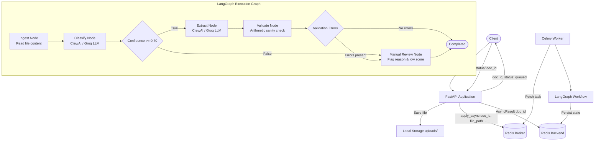

# AI Document Processing Agent

Asynchronous document classification, extraction, and validation pipeline built with FastAPI, Celery, Redis, LangGraph, and CrewAI.

## Overview

This repository implements an asynchronous document processing service designed to handle semi-structured business text (such as invoices, contracts, and correspondence). Incoming documents are ingested via HTTP, enqueued for background processing, classified using an LLM-based discriminator, and routed through a stateful graph that performs structured extraction and rule-based validation.

### System Capabilities

* **Decoupled Ingestion**: HTTP upload requests are acknowledged immediately with a tracking identifier, offloading execution to background Celery workers via Redis.
* **Discriminator Classification**: The classification stage uses chain-of-thought prompting to differentiate formal business records from informal correspondence discussing business records.
* **Stateful Conditional Routing**: Documents scoring at or above the confidence threshold (default: 0.70) proceed to extraction; documents below threshold route directly to manual review.
* **Deterministic Post-Extraction Validation**: Extracted fields undergo programmatic sanity checks (for example, invoice arithmetic validation where subtotal + tax must equal total). Failures divert the document to manual review.
* **Polling Interface**: A dedicated status endpoint exposes task progression and final payloads.

### Design Boundaries and Limitations

* **Input Formats**: Plain text files (`.txt`). Optical character recognition (OCR) for PDFs and images is outside the scope of this implementation.
* **Persistence Model**: Ephemeral. Files are stored on the local filesystem (`uploads/`) and task results are cached in the Celery Redis backend. A relational database is not configured.
* **Confidence Scoring**: Confidence values are model-generated numerical estimates produced via prompt instructions; they are not calibrated probabilities.
* **Access Control**: No authentication, authorization, or tenant isolation is implemented.

## Architecture



## Tech Stack

| Layer | Component | Notes |
| :--- | :--- | :--- |
| API Layer | FastAPI / Uvicorn | Request validation, file persistence, task dispatching |
| Task Queue | Celery | Distributed task execution with task tracking |
| Message Broker & Backend | Redis | Broker queue and task result storage |
| Orchestration | LangGraph | StateGraph workflow with conditional routing |
| Agent Execution | CrewAI / Groq | LLM integration using `llama-3.1-8b-instant` |
| Settings Management | Pydantic Settings | Typed configuration and runtime environment validation |
| Test Suite | Pytest | Unit and workflow tests with mocked network dependencies |

## Prerequisites

* Python 3.9 or higher (tested on Python 3.13)
* Redis server (running locally or accessible over network)
* Groq API key (required for live inference; mocked in automated tests)

## Environment Configuration

Configuration is managed via environment variables and loaded through Pydantic Settings.

Copy `.env.example` to `.env`:

```bash
# Windows
copy .env.example .env

# Linux / macOS
cp .env.example .env
```

Available configuration keys:

| Key | Default | Description |
| :--- | :--- | :--- |
| `GROQ_API_KEY` | None | API key for Groq LLM inference |
| `REDIS_URL` | `redis://localhost:6379/0` | Connection URL for Celery broker and result backend |
| `LLM_MODEL` | `groq/llama-3.1-8b-instant` | Model string passed to CrewAI |
| `CONFIDENCE_THRESHOLD` | `0.70` | Cutoff score for automated extraction vs. manual review |
| `UPLOAD_DIR` | `uploads` | Directory for storing uploaded files |

## Setup and Installation

1. Clone repository:
   ```bash
   git clone https://github.com/Devarsh009/ai-document-processing-agent.git
   cd ai-document-processing-agent
   ```

2. Create and activate a virtual environment:

   Windows (PowerShell):
   ```powershell
   python -m venv venv
   .\venv\Scripts\Activate.ps1
   ```

   Linux / macOS:
   ```bash
   python3 -m venv venv
   source venv/bin/activate
   ```

3. Install dependencies:
   ```bash
   pip install -r requirements.txt
   ```

## Running the Services

A complete local runtime requires three concurrent processes.

### 1. Start Redis
```bash
redis-server
```

### 2. Start Celery Worker

Windows (requires `--pool=solo` due to Windows process model constraints):
```bash
python -m celery -A app.workers.celery_app:celery_app worker --loglevel=info --pool=solo
```

Linux / macOS:
```bash
celery -A app.workers.celery_app:celery_app worker --loglevel=info
```

### 3. Start FastAPI Server
```bash
uvicorn app.main:app --reload
```

The service listens on `http://127.0.0.1:8000`. OpenAPI specifications and Swagger documentation are available at `http://127.0.0.1:8000/docs`.

## API Specification

### GET /health

Service liveness check.

Response (200 OK):
```json
{
  "status": "ok",
  "app": "ai-document-processing-agent",
  "version": "0.1.0"
}
```

### POST /process

Accepts a multipart file upload and enqueues it for background execution.

* Content-Type: `multipart/form-data`
* Field: `file` (raw text file)

Response (200 OK):
```json
{
  "status": "queued",
  "doc_id": "4a737f52-47de-4934-8b64-88f58b738e4a",
  "filename": "Invoice.txt"
}
```

Status Codes:
* `200 OK`: File stored and task enqueued successfully.
* `400 Bad Request`: Empty or invalid filename.
* `503 Service Unavailable`: Redis broker is unreachable.

### GET /status/{doc_id}

Queries processing progress and retrieves final state.

* Path parameter: `doc_id` (UUID format)

Response (200 OK, Completed Extraction):
```json
{
  "doc_id": "4a737f52-47de-4934-8b64-88f58b738e4a",
  "status": "completed",
  "filename": "Invoice.txt",
  "result": {
    "doc_id": "4a737f52-47de-4934-8b64-88f58b738e4a",
    "classification": "Invoice",
    "confidence_score": 0.95,
    "extracted_data": {
      "subtotal": 7500.0,
      "tax": 750.0,
      "total_due": 8250.0,
      "vendor": "CloudCompute Inc."
    },
    "validation_errors": [],
    "next_step": null
  },
  "error": null
}
```

Response (200 OK, Manual Review Triggered):
```json
{
  "doc_id": "4a737f52-47de-4934-8b64-88f58b738e4a",
  "status": "completed",
  "filename": "email.txt",
  "result": {
    "classification": "General_Correspondence",
    "confidence_score": 0.40,
    "extracted_data": {},
    "validation_errors": [
      "Confidence (0.4) below threshold (0.7)"
    ],
    "next_step": "manual_review"
  },
  "error": null
}
```

Status Codes:
* `200 OK`: Task found. Values for `status`: `queued`, `processing`, `completed`, `failed`.
* `400 Bad Request`: Format of `doc_id` is not a valid UUID.
* `404 Not Found`: No file or task metadata exists for the given ID.
* `503 Service Unavailable`: Celery backend (Redis) is unreachable.

## Automated Testing

The automated test suite runs offline without requiring network access to Groq or an active Redis daemon.

Run the test suite:
```bash
pytest -v
```

### Test Scope

* **JSON Output Parsing** (`tests/test_parser.py`): Strips markdown code blocks, extracts JSON embedded in conversational output, and falls back safely on parse failures.
* **Graph Nodes** (`tests/test_nodes.py`): Verifies file ingestion error handling, classification extraction, routing branches, and currency/numeric arithmetic validation.
* **Workflow Execution** (`tests/test_graph.py`): Validates end-to-end LangGraph transitions for successful extractions, low-confidence emails, and arithmetic mismatches.
* **API Endpoints** (`tests/test_api.py`): Verifies HTTP contract, file upload dispatching, error status codes, and task state lookups using mocked Celery results.

### Concurrency Simulation

To execute concurrent client requests against a running local server:
```bash
python test_script.py
```
This script uploads the sample documents in `test_samples/` using a thread pool and outputs polling endpoints.

## Performance and Metrics

* **Reported Prototype Extraction Rate**: Prior internal runs recorded 76% straight-through processing across a sample set of 100 documents, with the remaining 24% correctly routed to manual review. This metric is documented as a baseline reference; formal benchmark scripts and datasets are planned for future revisions.
* **Ingestion Latency vs. Processing Duration**: The `POST /process` endpoint responds in under 300 ms because it only validates and stages the file and enqueues a message to Redis. End-to-end task completion latency depends on worker concurrency, queue backlog, and LLM inference time.

## Repository Structure

```
ai-document-processing-agent/
├── app/
│   ├── agents/
│   │   ├── __init__.py
│   │   └── crew_runner.py     # LLM agent definitions and JSON parsing
│   ├── utils/
│   │   ├── __init__.py
│   │   ├── logger.py          # Application logging
│   │   └── state_store.py     # In-memory helper stub
│   ├── workers/
│   │   ├── __init__.py
│   │   ├── celery_app.py      # Celery broker and backend configuration
│   │   └── tasks.py           # Celery task definitions
│   ├── workflows/
│   │   ├── __init__.py
│   │   ├── graph.py           # LangGraph StateGraph orchestration
│   │   ├── nodes.py           # Ingestion, classification, validation nodes
│   │   └── state.py           # AgentState TypedDict schema
│   ├── config.py              # Pydantic Settings validation
│   └── main.py                # FastAPI endpoints and route handlers
├── test_samples/              # Sample documents (Invoice.txt, contract.txt, email.txt)
├── tests/                     # Automated pytest suite
│   ├── __init__.py
│   ├── test_api.py            # API endpoint unit tests
│   ├── test_graph.py          # Graph orchestration tests
│   ├── test_nodes.py          # Node logic and validation tests
│   └── test_parser.py         # Parser robustness tests
├── .env.example               # Environment variable template
├── .gitignore                 # Ignore patterns for build, cache, and Redis files
├── requirements.txt           # Pinned dependencies
├── test_script.py             # Concurrent upload simulation
└── README.md                  # System documentation
```